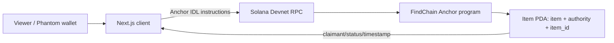

# FindChain

FindChain is a Solana lost-and-found dApp. Finders register found items, viewers browse public on-chain records, claimants claim items, and finders mark a claimed item returned before closing its account.

## Live application

Production URL: [https://findchain-web.vercel.app](https://findchain-web.vercel.app). The site is hosted on Vercel and connects to Solana Devnet by default.

## WayLearn Advanced — Requirements Mapping

Official route: **Proyecto propio**. The official requirements ask for a functional program, related accounts and PDAs, an IDL-aligned client, wallet frontend, account create/read/update, authority checks, a Rust-enforced conditional close, signature/confirmation/error handling, Devnet evidence, and reproducible documentation.

| Requirement | Implementation / evidence |
|---|---|
| PDA, creation, account data | `programs/findchain/src/lib.rs`, `create_item`; seeds `item`, authority, little-endian item id |
| Read/update and permissions | `update_item`; authority signer, PDA seeds, `has_one`, FOUND-only transition |
| Claim and return flow | `claim_item`, `mark_returned` |
| Conditional account close | `close_item`; Rust constraint only permits RETURNED and refunds authority |
| Client and wallet UI | `app/app/page.tsx`, generated IDL in `app/public/findchain.json`, Phantom wallet adapter |
| Local lifecycle tests | `tests/findchain.ts`, run with `anchor test`; creation, PDA derivation, read, update, unauthorized rejection, claim, duplicate rejection, early-close rejection, return, final close |
| Devnet deployment and functional evidence | [docs/evidence/devnet.md](docs/evidence/devnet.md), including finalized deployment and lifecycle signatures |

## Architecture

## Stack

- Solana Devnet, Anchor CLI, and an Anchor Rust program.
- Anchor-generated IDL shared with the TypeScript client.
- Next.js 15, React 19, Tailwind CSS 4, Phantom Wallet Adapter.
- Rust tests and TypeScript lifecycle tests; no application database or backend.

Versions used for the verified build: Solana CLI 3.1.10, Anchor CLI 1.1.2, Anchor Lang 1.2.2, SBF platform-tools 1.52 (Rust 1.89 toolchain), host Rust 1.100.0, Node.js 26.13.1, npm 11.20.0, Next.js 15.5.29, React 19.3.1, Anchor JS 0.31.1. Lockfiles pin the installed JavaScript dependency graph.



## Account and state rules

`Item` stores authority, item id, bounded title (64 bytes), description (280), general location (100), optional claimant, status, creation timestamp, and bump. Text is public on-chain: do not put names, contact details, home addresses, or personal photos in fields.

State flow: `Found -> Claimed -> Returned -> closed`. Only the authority edits a Found record, marks a Claimed record returned, and closes a Returned record. Claimants cannot claim their own record. All transitions are enforced in Rust.

## Requirements to run

- Solana CLI and Anchor CLI compatible with the versions in use.
- Rust toolchain, Node.js LTS, npm.
- Phantom or another Solana wallet for app transactions.

## Installation

1. Install Rust, Solana CLI, Anchor CLI, Node.js LTS, and npm. On Windows use a WSL2 Ubuntu terminal for the Rust/Solana toolchain.
2. Clone the repository and install its two JavaScript workspaces:

   ```bash
   git clone https://github.com/vincesmandres/findchain-solana.git
   cd findchain-solana
   npm ci
   cd app && npm ci && cd ..
   ```

3. For Devnet deployment, configure a deployer wallet that you control and keep it outside the repository:

   ```bash
   solana config set --url devnet
   solana config set --keypair ~/.config/solana/id.json
   solana address
   solana balance
   ```

4. Run `anchor build` and `anchor test` for local validation. Start the interface with `npm --prefix app run dev` and open `http://localhost:3000`.

## Environment variables

No secret environment variables are required. The app defaults to Devnet. To select a public RPC endpoint, copy `app/.env.example` to `app/.env.local` and set `NEXT_PUBLIC_SOLANA_RPC_URL`. Never put a private key, recovery phrase, or token in a `NEXT_PUBLIC_` value.

## Program ID

`69WsUdhb9Xnqc8Wacit3TDEpoFekvh9qDLpgidv7Rmo3` — deployed and verified on Devnet. See [Explorer](https://explorer.solana.com/address/69WsUdhb9Xnqc8Wacit3TDEpoFekvh9qDLpgidv7Rmo3?cluster=devnet) and [deployment/lifecycle evidence](docs/evidence/devnet.md).

## Build and local validation

```bash
npm ci                 # workspace test harness
cd app && npm ci       # frontend
cd ..
anchor build
anchor test            # local validator (Surfpool by default) and lifecycle suite
npm --prefix app run build
npm --prefix app run lint
```

The project started from the Anchor `anchor init` Rust scaffold; its counter example was replaced with FindChain's item state machine. The frontend loads the generated IDL and submits those same program instructions.

## Own contribution

FindChain adds a lost-and-found lifecycle beyond the generated counter: deterministic per-finder item PDAs, bounded public metadata, Rust-enforced permissions, claimant tracking, the `FOUND -> CLAIMED -> RETURNED` state machine, and a close operation allowed only after return. The lifecycle tests reproduce both accepted and rejected operations locally and on Devnet.

## Devnet

Use a local deployer keypair securely, never commit it, and set the Solana CLI/Anchor provider to Devnet. Then run `anchor build` and `anchor deploy --provider.cluster devnet`. Verify the program and transactions at [Solana Explorer Devnet](https://explorer.solana.com/?cluster=devnet). The deployed ID and observed signatures are recorded in `docs/evidence/devnet.md`.

For integration checks against the already deployed program, run `anchor test --skip-local-validator --skip-build --skip-deploy --provider.cluster devnet`. This signs real transactions and uses Devnet SOL; the recorded test lifecycle closes its item PDA.

## Certificate identification

- Full name: `[enter manually]`
- Email used for WayLearn registration: `[enter manually]`

## Evidence

`docs/evidence/devnet.md` records confirmed Devnet signatures. `docs/evidence/CAPTURES.md` lists screenshots to capture from a real local UI session; no screenshots are fabricated.

The dependency audit and remaining moderate upstream advisories are recorded in `docs/evidence/security-audit.md`.
